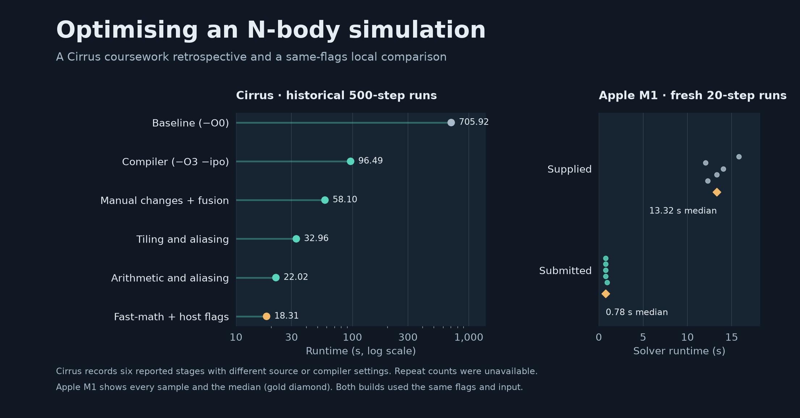

# N-body Performance Study

A CPU performance case study based on my 2024–25 MSc Performance Programming
work at the University of Edinburgh. I profiled a supplied gravitational
simulation on Cirrus and investigated how compiler options, loop fusion and
cache blocking affected its runtime. A follow-up experiment rebuilds the
supplied and submitted C implementations with the same compiler flags.



## What changed

The supplied solver computed and stored particle-pair separations before a
later pass accumulated forces. The submitted version computed each pair's
interaction when needed and updated both particles' forces. It grouped the
pair loops into blocks and cached reused values. The number of pair
interactions still grows quadratically. The optimization changes the memory
access pattern and the order of floating-point operations.

## Cirrus coursework results

| 500-step configuration | Reported runtime |
| --- | ---: |
| Unoptimised baseline (`-O0`) | 705.92 s |
| Compiler optimisation (`-O3 -ipo`) | 96.49 s |
| Manual optimisation and loop fusion | 58.10 s |
| Tiling and aliasing changes | 32.96 s |
| Further arithmetic and aliasing changes | 22.02 s |
| Exploratory fast-math and host flags | 18.31 s |

These are the six stages in the submitted report's summary table. The
96.49-to-18.31-second comparison spans several source changes and a change
in compiler settings. The archived 100-step snapshot is byte-identical to
its saved reference. An equivalent-time reference is unavailable for the
later snapshots.

## Fresh local comparison

On an Apple M1, both C builds ran the same 4,096-particle input with identical
Apple Clang flags. Across five fresh processes per implementation, the median
runtime for the first 20 steps was **13.32 s for the supplied version**
and **0.78 s for the submitted version** (17.1× ratio).

Both builds produced byte-identical serialized snapshots at 20 and 100 steps.
The 100-step output also matched the saved reference. Neither build reported a
collision in these runs, so the check covers this input's collision-free
trajectory. Both timings include the full solver call, including memory
allocations and progress logging.

The archived driver normally calls the solver five times. I used one call
per process because the saved optimized source can use uninitialised
coefficients on a later call at the same timestep. This limits the fresh
measurement to a single call. The chart and tables report the Cirrus and Mac
experiments independently.

## Recreate the figures

Python 3.11 was used for this case study.

```sh
python3 -m venv .venv
. .venv/bin/activate
python -m pip install -r requirements.txt
python scripts/plot_results.py
```

The script reads the [Cirrus timing table](data/cirrus-stages.csv) and
[raw local timings](data/local-comparison.json) to regenerate the PNG and SVG
in `figures/`. The [archive check](data/archive-check.json) records the
snapshot comparison. See the [measurement method](docs/method.md) for the
source attribution, controlled conditions and limits of the comparison.
